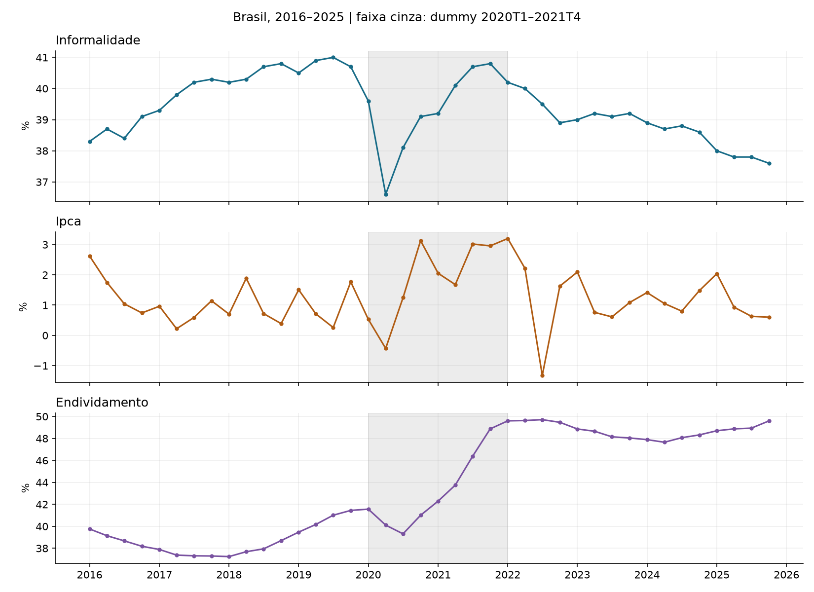
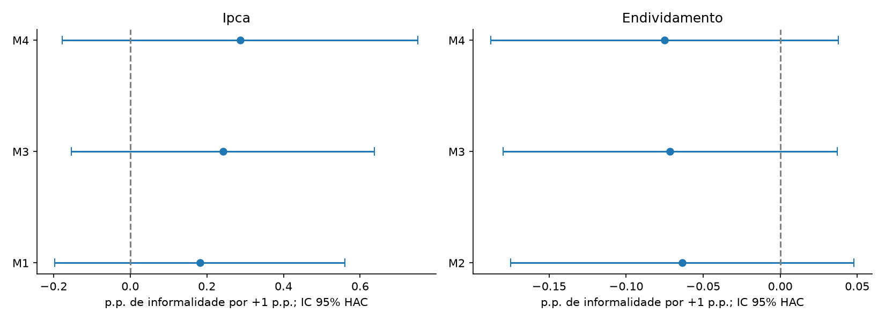
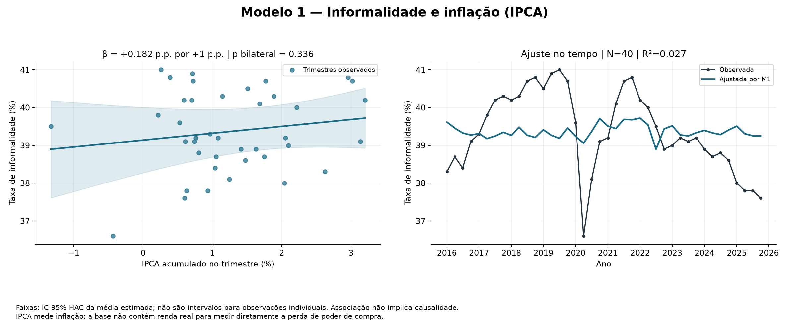
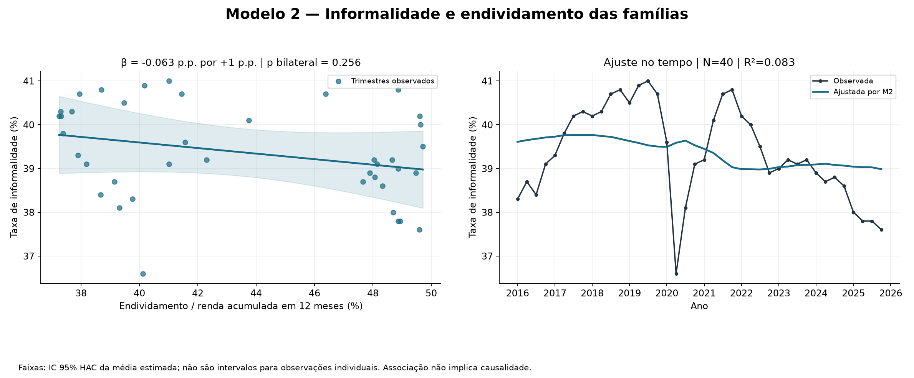
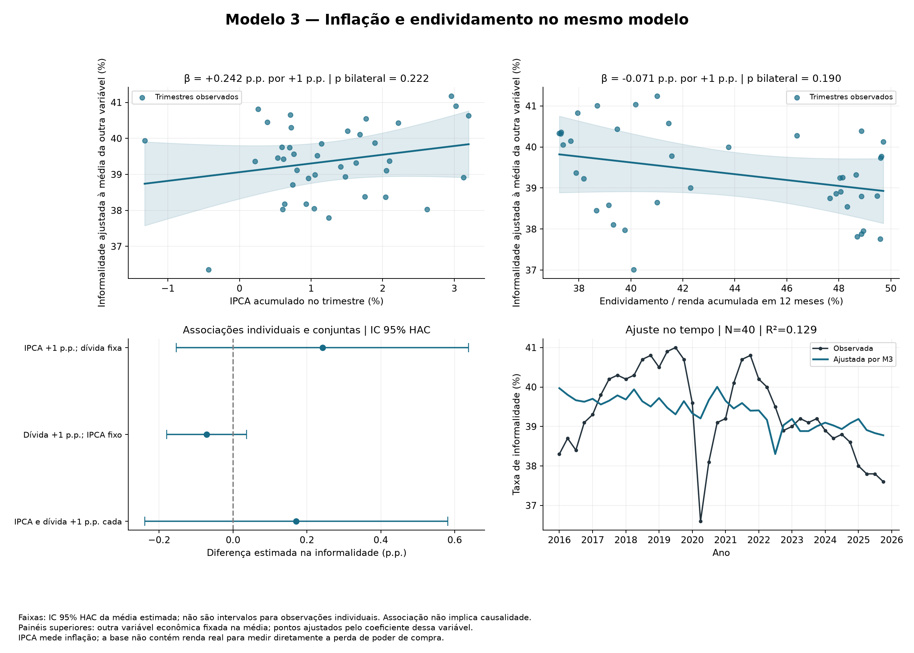
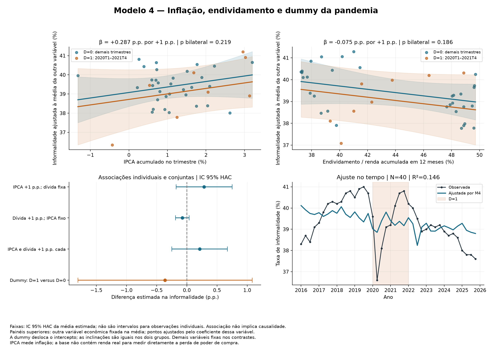
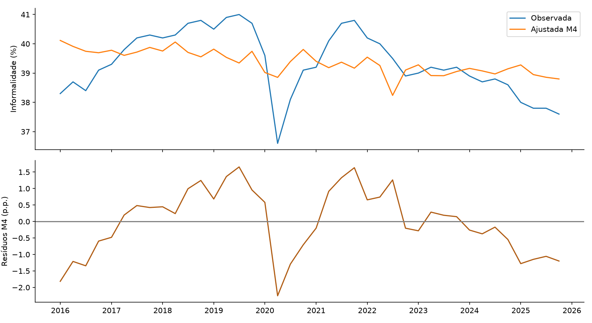
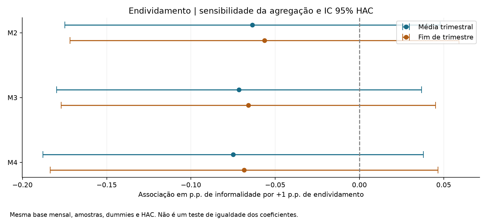
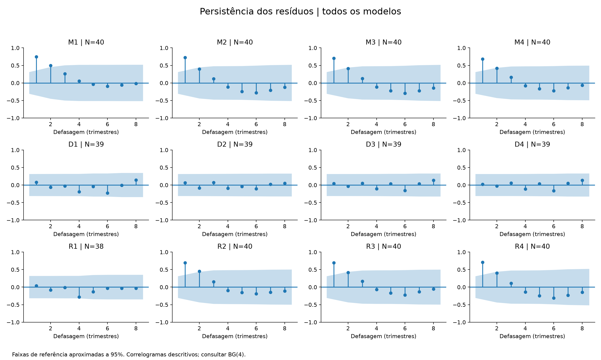

# Atividade 11 — Inflação, endividamento e informalidade no Brasil

## Revisão técnica e estado da validação

Esta versão incorpora o parecer técnico, mantendo M1–M4 e a dummy 2020T1–2021T4. As tabelas, os gráficos e as interpretações anteriores permanecem disponíveis. A análise distingue a correspondência com as fontes, a reprodução dos cálculos e a adequação econômica e temporal da especificação. A primeira e a segunda não demonstram a terceira.

| dimensao | situacao | evidencia_ou_limite |
| --- | --- | --- |
| Dados | Comparação oficial executada | As 120 observações trimestrais (40 de cada variável) coincidem com a versão oficial consultada, à tolerância absoluta de 1e−8 p.p. |
| Cálculos | 12 modelos reproduzidos | Matrizes, amostras, MQO, HAC, t, F, IC95%, BG, BP e VIF conferidos por cálculo separado. |
| Agregação | Sensibilidade executada | A substituição da média pelo último mês preserva os sinais e as decisões bilaterais a 5% dos coeficientes econômicos de M1–M4. |
| Séries temporais | Diagnóstico ampliado; validação limitada | ADF/KPSS sensíveis à especificação; quebras não resolvem a incerteza sobre a integração. |
| Especificação | Limitação reconhecida | Os modelos dinâmicos são exploratórios; não há identificação causal nem controles econômicos adicionais nesta base. |

M4 é a referência descritiva principal da apresentação, justificada pela pergunta econômica e pela parcimônia. Os modelos em nível não constituem evidência temporal já validada. Os testes de significância são apresentados como resultados condicionais às especificações; a persistência e a autocorrelação impedem transformar sua correção aritmética em conclusão definitiva. A análise em diferenças e R1 permanece exploratória, com hipóteses econômicas distintas. Não foi escolhido um modelo pelo menor p-valor.

## Objetivo e problema de pesquisa

Investigar se o aumento da inflação e do endividamento das famílias está associado ao aumento da taxa de informalidade no Brasil, entre 2016T1 e 2025T4. A hipótese econômica é que a pressão sobre os orçamentos familiares pode estimular ocupações informais. A direção e a intensidade são questões empíricas; este desenho não identifica causalidade.

## Base, medidas e conferência

Amostra: 40 trimestres civis consecutivos. Sem interpolação ou imputação. A comparação externa usa snapshots oficiais separados, sem substituir a base fornecida. O arquivo original foi preservado em data/input. A consistência interna foi conferida por trimestre, recompondo o IPCA mensal e a média do endividamento. Erros máximos: IPCA 7.11e-15 e endividamento 0.00e+00. A auditoria externa desta revisão está documentada a seguir. A data de extração da planilha original não é conhecida; a coincidência com a versão consultada não reconstitui seu histórico de revisões.

- I: informalidade em % dos ocupados, conforme a planilha; não é quantidade de trabalhadores informais.
- π: IPCA acumulado no trimestre em %, calculado por 100 × [∏(1 + IPCA_m/100) − 1].
- E: Endividamento das famílias com o Sistema Financeiro Nacional em relação à renda acumulada em 12 meses (SGS 29037), em %, média dos três meses. Após esta definição, usa-se a abreviação endividamento das famílias. Não é percentual de famílias endividadas nem inadimplência.
- D: 1 de 2020T1 a 2021T4 e 0 nos demais trimestres. São 8 observações com D=1. É uma janela analítica adotada, não uma afirmação de encerramento sanitário ou legal da pandemia.

O IPCA mede a variação dos preços. Sem renda nominal ou real, não se observa diretamente a perda de poder de compra. Para renda nominal fixa, a perda percentual no trimestre seria 100 × [1 − 1/(1 + π/100)], uma transformação da inflação, que não acrescenta informação independente. Não incluir essa transformação junto com o IPCA como se fossem dois canais distintos. Para testar o mecanismo de renda, obter rendimento real e justificar seu papel como variável explicativa ou mediadora.

## Auditoria das fontes oficiais

Consulta em 2026-11-03, com datas e horários no fuso America/Sao_Paulo registrados no manifesto. As 120 observações trimestrais (40 de cada variável) coincidem com a versão oficial consultada, à tolerância absoluta de 1e−8 p.p. Além da conferência trimestral, cada um dos 120 meses de IPCA e dos 120 meses de endividamento foi comparado individualmente aos valores da planilha. O arquivo original permanece intacto. As diferenças indicadas são planilha menos fonte oficial, em pontos percentuais; números muito pequenos podem refletir precisão de ponto flutuante.

| variavel | observacoes | conferidas | coincidentes | erro_maximo_pp | divergentes | status |
| --- | --- | --- | --- | --- | --- | --- |
| informalidade | 40 | 40 | 40 | 0.0000 | 0 | Conferida com a versão consultada |
| ipca | 40 | 40 | 40 | 7.105e-15 | 0 | Conferida com a versão consultada |
| endividamento | 40 | 40 | 40 | 0.0000 | 0 | Conferida com a versão consultada |

Informalidade: SIDRA 8529, variável 12466, Brasil (nível territorial N1, código 1), unidade percentual e PNAD Contínua trimestral. Os códigos AAAA01 a AAAA04 representam trimestres civis; não foram utilizadas observações de trimestres móveis sobrepostos. IPCA: SIDRA 1737, variável 63 (variação mensal), Brasil, percentual; meses janeiro–março, abril–junho, julho–setembro e outubro–dezembro compostos dentro do trimestre. Endividamento: SGS 29037, mensal, percentual, agregado pela média dos mesmos três meses.

Conforme a [definição divulgada pelo IBGE](https://agenciadenoticias.ibge.gov.br/agencia-sala-de-imprensa/2013-agencia-de-noticias/releases/44244-pnad-continua-trimestral-desocupacao-cai-em-18-das-27-ufs-no-segundo-trimestre-de-2025), a proxy de informalidade inclui empregados privados e domésticos sem carteira, empregadores e trabalhadores por conta própria sem CNPJ e trabalhadores familiares auxiliares no trabalho principal. A definição corrente é comum à série consultada. Isso não certifica ausência de mudanças de coleta ou ponderação ao longo do tempo. O IBGE documenta reponderações históricas nas [notas metodológicas da PNAD Contínua](https://www.ibge.gov.br/estatisticas/sociais/trabalho/9173-informalidade.html), incluindo a atualização de pesos em 2025. Usar uma única extração evita combinar versões atuais distintas, mas não permite reconstruir valores de publicações antigas sem os arquivos da época.

As respostas oficiais, URLs, carimbos de extração e SHA-256 estão em [manifesto de fontes](../input/fontes_oficiais/manifesto.json). A conferência individual está em [auditoria trimestral](fontes_trimestres.csv) e [auditoria mensal](fontes_meses.csv), também em abas da planilha. A execução padrão reutiliza esses snapshots; a atualização online é uma ação explícita com --atualizar-fontes.

## Os quatro modelos solicitados

Estimação por mínimos quadrados ordinários com intercepto:

1. M1: I_t = α + βπ π_t + u_t.
2. M2: I_t = α + βE E_t + u_t.
3. M3: I_t = α + βπ π_t + βE E_t + u_t.
4. M4: I_t = α + βπ π_t + βE E_t + δ D_t + u_t.

A hipótese motivadora propõe βπ > 0 e βE > 0, sem impor esses sinais às estimativas. Esses sinais não são necessários em termos teóricos: mudanças na atividade, no crédito e na composição da ocupação podem produzir associações distintas. Os modelos simples estimam associações brutas; M3 e M4 estimam associações parciais. Em M4, δ é um deslocamento médio do intercepto na janela definida, mantendo IPCA e endividamento constantes. A dummy procura captar diferenças na informalidade durante 2020 e 2021 que não são explicadas pelo IPCA e pelo endividamento incluídos. Não estima mudança de inclinação nem isola o efeito causal da pandemia; outros acontecimentos da janela também podem influenciar seu coeficiente.

Todas as variáveis originais estão em escala percentual (38,3 significa 38,3%, não 0,383). Cada β expressa a diferença em pontos percentuais da informalidade associada a +1 ponto percentual na explicativa. Esse coeficiente não é elasticidade. Os erros u_t capturam fatores omitidos.

## Fundamentação da especificação principal

M4 é adotado como referência descritiva principal da apresentação: I_t = α + βπ π_t + βE E_t + δD_t + u_t. A pergunta operacional é se, no mesmo trimestre, a inflação e o nível do endividamento das famílias apresentam associação parcial com a taxa de informalidade, considerada a janela de 2020 e 2021. A escolha organiza os resultados da análise original; não decorre do menor p-valor, do maior R² ou da significância de outro modelo. Ela não transforma a regressão em nível em um modelo temporal validado.

A presença conjunta de π_t e E_t distingue as duas associações: βπ compara observações com o mesmo endividamento e D, enquanto βE compara observações com a mesma inflação e D. São interpretações condicionais da equação estimada, e não comparações experimentais. A variável dependente é uma proporção dos ocupados; por isso, esses parâmetros não medem criação de trabalho informal nem a passagem individual de uma pessoa da formalidade à informalidade.

A inflação pode pressionar o orçamento quando a renda nominal não acompanha os preços, e o indicador dívida/renda pode refletir pressão financeira. Esses mecanismos motivam a pergunta, mas não são identificados pelas variáveis disponíveis. O IPCA não observa renda real, e o endividamento também pode acompanhar expansão de crédito e atividade. Assim, a fundamentação admite sinais ambíguos e não trata o sinal proposto como uma restrição do modelo.

D_t permite um deslocamento médio do intercepto durante os oito trimestres de 2020T1–2021T4, uma janela analítica de perturbação comum ao mercado de trabalho e às variáveis econômicas. Ela mantém inclinações comuns entre períodos e não controla automaticamente todas as mudanças ocorridas nessa janela. A equação permanece parcimoniosa, com intercepto e três regressores em 40 observações; essa parcimônia é uma escolha de escopo e não garante ausência de viés por variáveis omitidas.

M1 e M2 mostram associações brutas; M3 permite examinar as duas variáveis econômicas conjuntamente; M4 acrescenta a janela da pandemia. Essa sequência explica o papel das especificações sem tratar a estabilidade entre elas como teste de robustez causal. D1–D4 descrevem mudanças, com ΔIPCA medindo aceleração inflacionária. R1 descreve associações com defasagens e controles sazonais. R2–R4 exploram tendência e janelas alternativas. São perguntas e sensibilidades complementares; nenhum desses modelos substitui M4 apenas porque tem um teste significativo.

Para fundamentar inferência temporal principal seria necessário justificar melhor a dinâmica e as propriedades das séries e discutir a plausibilidade de exogeneidade em relação aos fatores omitidos. HAC não fornece essas justificativas. Com a evidência atual, a escolha de M4 como referência de apresentação é defensável pela pergunta e pela transparência, enquanto sua interpretação permanece descritiva e condicional. Não há um modelo de longo prazo ou causal estabelecido neste estudo.

## Inferência e hipóteses

Erros-padrão HAC de Newey–West, kernel Bartlett, 4 defasagens, correção de amostra finita e referência t com graus de liberdade residuais. A janela principal de quatro defasagens cobre até um ano; sensibilidades com uma, duas e quatro defasagens para todos os coeficientes estão em sensibilidade_hac.csv, e para os testes F globais e econômicos em sensibilidade_f_hac.csv. HAC modifica a inferência, não os coeficientes, e não corrige regressão espúria, endogeneidade ou a equação da média.

A tabela principal usa H0: β=0 contra H1: β≠0, IC95% e significância de 5%. O arquivo de coeficientes também apresenta o teste direcional pré-especificado H0: β≤0 contra H1: β>0; para coeficiente negativo, o p unilateral positivo é grande. Não escolher a cauda após observar os resultados. O teste F robusto de M3/M4 avalia H0: βπ=βE=0; rejeitá-lo não implica que ambos sejam positivos ou individualmente significativos. A dummy fica fora dessa restrição conjunta. A amostra pequena exige cautela mesmo com HAC.

## Resultados dos quatro modelos em nível

| modelo | termo | coeficiente | ep_hac | p_bilateral | ic95_inferior | ic95_superior |
| --- | --- | --- | --- | --- | --- | --- |
| M1 | ipca | 0.1822 | 0.1871 | 0.3362 | -0.1965 | 0.5609 |
| M2 | endividamento | -0.0635 | 0.0550 | 0.2556 | -0.1748 | 0.0479 |
| M3 | ipca | 0.2424 | 0.1952 | 0.2221 | -0.1531 | 0.6378 |
| M3 | endividamento | -0.0714 | 0.0535 | 0.1897 | -0.1798 | 0.0369 |
| M4 | ipca | 0.2866 | 0.2289 | 0.2185 | -0.1776 | 0.7507 |
| M4 | endividamento | -0.0749 | 0.0556 | 0.1863 | -0.1878 | 0.0379 |
| M4 | pandemia | -0.3608 | 0.7125 | 0.6157 | -1.8057 | 1.0842 |

| modelo | n | r2 | r2_ajustado | p_f_hac_explicativas |
| --- | --- | --- | --- | --- |
| M1 | 40 | 0.0266 | 0.0010 | 0.3362 |
| M2 | 40 | 0.0832 | 0.0591 | 0.2556 |
| M3 | 40 | 0.1291 | 0.0820 | 0.2029 |
| M4 | 40 | 0.1461 | 0.0749 | 0.2453 |

M1, ipca: coeficiente 0.1822; p bilateral 0.3362; IC95% [-0.1965; 0.5609]. Há evidência insuficiente de associação diferente de zero a 5% no teste bilateral.
M2, endividamento: coeficiente -0.0635; p bilateral 0.2556; IC95% [-0.1748; 0.0479]. Há evidência insuficiente de associação diferente de zero a 5% no teste bilateral.
M3, ipca: coeficiente 0.2424; p bilateral 0.2221; IC95% [-0.1531; 0.6378]. Há evidência insuficiente de associação diferente de zero a 5% no teste bilateral.
M3, endividamento: coeficiente -0.0714; p bilateral 0.1897; IC95% [-0.1798; 0.0369]. Há evidência insuficiente de associação diferente de zero a 5% no teste bilateral.
M4, ipca: coeficiente 0.2866; p bilateral 0.2185; IC95% [-0.1776; 0.7507]. Há evidência insuficiente de associação diferente de zero a 5% no teste bilateral.
M4, endividamento: coeficiente -0.0749; p bilateral 0.1863; IC95% [-0.1878; 0.0379]. Há evidência insuficiente de associação diferente de zero a 5% no teste bilateral.
M4, pandemia: coeficiente -0.3608; p bilateral 0.6157; IC95% [-1.8057; 1.0842]. Há evidência insuficiente de associação diferente de zero a 5% no teste bilateral.

A interpretação adequada é condicional aos modelos e à qualidade das séries. Ausência de significância não demonstra ausência de associação. Um sinal negativo não significativo tampouco permite afirmar que a dívida reduz a informalidade.

## O que os testes permitem concluir

A leitura começa pela magnitude estimada e pelo IC95%, e depois considera o p-valor em relação à hipótese específica. Para um aumento de 1 p.p. em uma explicativa, o coeficiente expressa a associação em p.p. da informalidade, mantidas as demais variáveis da equação. Um intervalo que contém zero representa incerteza sobre direção e magnitude nesta configuração; não demonstra equivalência prática a zero. Não foi definido um limiar de relevância econômica nem realizado teste de equivalência.

| teste_ou_diagnostico | objeto | resultado_ou_leitura | limite_da_conclusao |
| --- | --- | --- | --- |
| t bilateral e IC95% de M4 | Associação parcial de cada regressor, condicionada aos demais | IPCA e endividamento: incerteza compatível com coeficientes nulos nesta configuração. | Não demonstram inexistência de relação, causalidade ou irrelevância econômica. |
| F econômico de M4 | IPCA e endividamento conjuntamente iguais a zero | F=1.4615; p=0.2453. | Não testa se ambos os coeficientes são positivos nem a validade temporal da equação. |
| F global de R1 | Todos os regressores, incluindo dinâmica, pandemia e sazonalidade | F=4.8076; p=0.0010. | Sua rejeição não identifica qual bloco explica o resultado nem valida R1 como principal. |
| F econômico de R1 | Inflação defasada e variação do endividamento defasada conjuntamente nulas | F=2.1804; p=0.1306. | A rejeição global de R1 não deve ser apresentada como confirmação da hipótese econômica. |
| BG, ADF/KPSS e VIF | Dependência residual, propriedades temporais e colinearidade | Diagnósticos com objetos distintos; nenhum equivale à validação integral da especificação. | VIF baixo e não rejeição de BG não comprovam exogeneidade, estacionariedade ou causalidade. |

Todos os testes HAC usam referências aproximadas nesta amostra e são condicionais à especificação. Os valores-p apresentados não corrigem a possibilidade de regressão espúria ou de endogeneidade. Por isso, a leitura adequada dos coeficientes econômicos de M4 é de evidência insuficiente nesta configuração para distingui-los de zero, e não de ausência demonstrada de associação na população.

Em R1, o F global e o F econômico respondem a perguntas diferentes. O primeiro inclui controles e dinâmica; o segundo restringe apenas os dois regressores econômicos. O contraste entre seus resultados impede usar a rejeição global como confirmação de que inflação e endividamento estejam associados positivamente à informalidade. Os testes são apresentados integralmente, sem eleger R1 como modelo principal por esse resultado.

As rejeições encontradas em D2–D4 ao usar endividamento de fim de trimestre são sensibilidades exploratórias. A mudança de agregação altera o comportamento da variação do indicador e pode alterar inferência; não é uma confirmação independente, pois usa a mesma amostra mensal. Como há várias especificações e testes sem ajuste por multiplicidade, rejeições isoladas não sustentam uma narrativa confirmatória.

## Gráficos individuais dos quatro modelos

Cada modelo tem um arquivo PNG e um PDF. Os painéis exibem relações estimadas e o ajuste da informalidade ao longo do tempo. M3 e M4 apresentam também contrastes para aumentos individuais e simultâneos de 1 p.p. no IPCA e no endividamento, com intervalos calculados usando a covariância HAC completa. Nos painéis condicionais, a outra explicativa econômica fica na média e os pontos observados são ajustados para esse mesmo valor. Em M4, as curvas distinguem D=0 e D=1; o contraste da dummy compara os grupos com IPCA e endividamento fixos. São associações estimadas, não efeitos causais. As faixas representam a incerteza da média estimada, não a dispersão dos dados individuais.

### M1 — Informalidade e inflação

### M2 — Informalidade e endividamento

### M3 — Inflação e endividamento no mesmo modelo

### M4 — Inflação, endividamento e pandemia

## Séries temporais e verificações de robustez

Os quatro modelos em nível são referências descritivas. A pergunta sobre aumentos requer examinar também mudanças no tempo:

- D1–D4 usam ΔI como dependente e Δπ e/ou ΔE como explicativas. Em D4, a dummy é ΔD, pois se diferencia a equação M4: representa entrada e saída da janela. Δπ é aceleração/desaceleração da inflação trimestral, não o IPCA trimestral em si; ΔE é a mudança do indicador de dívida, não o crescimento percentual do estoque de dívida.
- R1: ΔI_t = α + ρΔI_(t−1) + θπ π_(t−1) + θE ΔE_(t−1) + δD_t + sazonalidade + u_t. Examina se inflação anterior e aumento anterior do indicador de dívida se associam à mudança atual da informalidade. A dummy em nível neste modelo permite uma mudança média na variação da informalidade durante a janela. É uma especificação diferente de D4. As duas primeiras observações são perdidas (N=38). Defasagens não eliminam endogeneidade.
- R2 acrescenta tendência linear e dummies sazonais a M4 (T1 como referência).
- R3 usa janela 2020T2–2021T4; R4 usa 2020T1–2023T2. As janelas são sensibilidades analíticas, não datas oficiais de uma mesma definição de pandemia.

| modelo | termo | coeficiente | p_bilateral | ic95_inferior | ic95_superior |
| --- | --- | --- | --- | --- | --- |
| D4 | d_ipca | 0.1026 | 0.4133 | -0.1490 | 0.3541 |
| D4 | d_endividamento | 0.2366 | 0.1056 | -0.0526 | 0.5258 |
| R1 | ipca_lag1 | 0.1527 | 0.3832 | -0.1997 | 0.5052 |
| R1 | d_endividamento_lag1 | -0.2487 | 0.0727 | -0.5217 | 0.0243 |
| R2 | ipca | 0.2420 | 0.1284 | -0.0738 | 0.5578 |
| R2 | endividamento | 0.0333 | 0.8036 | -0.2374 | 0.3041 |
| R3 | ipca | 0.3088 | 0.2275 | -0.2013 | 0.8189 |
| R3 | endividamento | -0.0753 | 0.1846 | -0.1881 | 0.0376 |
| R4 | ipca | 0.2314 | 0.3082 | -0.2226 | 0.6855 |
| R4 | endividamento | -0.0740 | 0.2098 | -0.1915 | 0.0435 |

D4, d_ipca: coeficiente 0.1026; p bilateral 0.4133; IC95% [-0.1490; 0.3541]. Há evidência insuficiente de associação diferente de zero a 5% no teste bilateral. D4, d_endividamento: coeficiente 0.2366; p bilateral 0.1056; IC95% [-0.0526; 0.5258]. Há evidência insuficiente de associação diferente de zero a 5% no teste bilateral.

R1, ipca_lag1: coeficiente 0.1527; p bilateral 0.3832; IC95% [-0.1997; 0.5052]. Há evidência insuficiente de associação diferente de zero a 5% no teste bilateral. R1, d_endividamento_lag1: coeficiente -0.2487; p bilateral 0.0727; IC95% [-0.5217; 0.0243]. Há evidência insuficiente de associação diferente de zero a 5% no teste bilateral.

Não selecionar a especificação pelo menor p-valor. As especificações respondem a perguntas distintas. O R² de modelos com dependentes diferentes não deve ser comparado; AIC/BIC só devem orientar comparações com a mesma dependente e a mesma amostra.

## Sensibilidade da agregação do endividamento

A média trimestral foi mantida porque representa o nível médio do endividamento durante o mesmo intervalo de três meses em que se observa o mercado de trabalho. O último mês representa a posição no encerramento, e não uma média do trimestre. Para separar essa escolha de uma mudança da fonte, esta sensibilidade usa exclusivamente os três valores mensais da planilha original; substitui-se a média por e3, e todas as diferenças e defasagens são reconstruídas.

Os 12 modelos foram reestimados com o endividamento de fim de trimestre, mantendo amostras, equações, dummies e a configuração HAC. A substituição da média pelo último mês preserva os sinais e as decisões bilaterais a 5% dos coeficientes econômicos de M1–M4. Essa estabilidade da decisão a 5% em M1–M4 não demonstra equivalência dos parâmetros nem estabilidade nos modelos complementares. M1/D1 não usam endividamento e funcionam como referências invariantes.

| modelo | termo | coef_media | coef_fim | diferenca_coef | p_media | p_fim | mudou_sinal | mudou_decisao_5pct |
| --- | --- | --- | --- | --- | --- | --- | --- | --- |
| M1 | ipca | 0.1822 | 0.1822 | 0.0000 | 0.3362 | 0.3362 | False | False |
| M2 | endividamento | -0.0635 | -0.0563 | 0.0072 | 0.2556 | 0.3291 | False | False |
| M3 | ipca | 0.2424 | 0.2479 | 0.0055 | 0.2221 | 0.2162 | False | False |
| M3 | endividamento | -0.0714 | -0.0659 | 0.0056 | 0.1897 | 0.2371 | False | False |
| M4 | ipca | 0.2866 | 0.2882 | 0.0016 | 0.2185 | 0.2195 | False | False |
| M4 | endividamento | -0.0749 | -0.0684 | 0.0065 | 0.1863 | 0.2356 | False | False |

| modelo | n_media | n_fim | r2_media | r2_fim | p_f_global_media | p_f_global_fim | bg_p_fim | bp_p_fim |
| --- | --- | --- | --- | --- | --- | --- | --- | --- |
| M1 | 40 | 40 | 0.0266 | 0.0266 | 0.3362 | 0.3362 | 5.764e-05 | 0.0639 |
| M2 | 40 | 40 | 0.0832 | 0.0661 | 0.2556 | 0.3291 | 8.618e-05 | 0.5859 |
| M3 | 40 | 40 | 0.1291 | 0.1135 | 0.2029 | 0.2443 | 0.0002 | 0.2913 |
| M4 | 40 | 40 | 0.1461 | 0.1279 | 0.3992 | 0.4556 | 0.0003 | 0.1373 |
| D1 | 39 | 39 | 0.0496 | 0.0496 | 0.3635 | 0.3635 | 0.7315 | 0.8309 |
| D2 | 39 | 39 | 0.1005 | 0.2909 | 0.1096 | 0.0407 | 0.8322 | 0.0080 |
| D3 | 39 | 39 | 0.1295 | 0.2987 | 0.2651 | 0.0638 | 0.8751 | 0.0191 |
| D4 | 39 | 39 | 0.1306 | 0.3040 | 0.3932 | 0.0911 | 0.8551 | 0.0435 |
| R1 | 38 | 38 | 0.1553 | 0.1882 | 0.0010 | 0.0032 | 0.1748 | 0.0103 |
| R2 | 40 | 40 | 0.2178 | 0.2313 | 0.3924 | 0.3825 | 0.0001 | 0.1589 |
| R3 | 40 | 40 | 0.1540 | 0.1352 | 0.4106 | 0.4668 | 0.0002 | 0.0855 |
| R4 | 40 | 40 | 0.1305 | 0.1145 | 0.3341 | 0.3983 | 0.0002 | 0.1462 |

Nos complementares, a mudança de agregação torna a variação do endividamento significativa em D2–D4 e a defasagem da variação da informalidade significativa em R1. As decisões que mudam estão abaixo. D2 também passa a rejeitar o F global a 5%. Essas alterações mostram sensibilidade material e impedem generalizar a estabilidade de M1–M4 para toda a análise. Não se escolhe o fim de trimestre por produzir significância.

| modelo | termo | coef_media | coef_fim | p_media | p_fim | mudou_decisao_5pct |
| --- | --- | --- | --- | --- | --- | --- |
| D2 | d_endividamento | 0.2632 | 0.4149 | 0.1096 | 0.0407 | True |
| D3 | d_endividamento | 0.2383 | 0.3970 | 0.1070 | 0.0323 | True |
| D4 | d_endividamento | 0.2366 | 0.3997 | 0.1056 | 0.0379 | True |
| R1 | d_informalidade_lag1 | 0.1420 | 0.2702 | 0.3972 | 0.0438 | True |

Coeficientes, erros-padrão, intervalos e decisões de todas as variáveis estão em agregacao_coeficientes.csv. A planilha também contém testes t e F, diagnósticos e multicolinearidade da variante de fim de trimestre. Esta variante passou pela mesma reprodução matricial da especificação original.

## Multicolinearidade — todos os modelos

Os diagnósticos abaixo usam exatamente a matriz de regressores e a amostra efetivamente utilizada em cada modelo, incluindo dummies, tendência e defasagens. O intercepto participa das regressões auxiliares do VIF, mas não recebe classificação. A variável dependente não entra nesta avaliação.

VIF_j = 1/(1 − R²_j), em que R²_j vem da regressão da explicativa j nas demais explicativas e no intercepto. A tolerância é 1/VIF. Como referências descritivas, VIF < 5 indica baixa colinearidade, 5 ≤ VIF < 10 requer atenção e VIF ≥ 10 sinaliza colinearidade elevada (tolerância ≤ 0,10). Nos modelos com apenas uma explicativa, VIF = 1 por construção. As dummies sazonais são avaliadas por coluna, com T1 como referência.

O número de condição é a razão entre o maior e o menor valor singular da matriz das explicativas centradas e padronizadas, excluindo o intercepto; isso evita atribuir às unidades de medida uma colinearidade artificial. Valores de 10 a 30 requerem atenção e ≥ 30 indicam condição elevada. A verificação de posto inclui o intercepto e detecta dependência linear exata; nesse caso, o número de condição é infinito. Os limites são heurísticos, não testes de hipótese com p-valor, e não justificam excluir controles automaticamente. HAC não corrige multicolinearidade.

Variáveis com VIF ≥ 5: R2, endividamento: VIF=6.7152, tolerância=0.1489; R2, tendencia: VIF=6.4464, tolerância=0.1551. Não foi detectada dependência linear exata em nenhum modelo.

| modelo | n | numero_regressores | posto_matriz_com_intercepto | colunas_com_intercepto | dependencia_linear_exata | numero_condicao_padronizado | avaliacao_condicao | vif_maximo |
| --- | --- | --- | --- | --- | --- | --- | --- | --- |
| M1 | 40 | 1 | 2 | 2 | False | 1.0000 | Baixa (< 10) | 1.0000 |
| M2 | 40 | 1 | 2 | 2 | False | 1.0000 | Baixa (< 10) | 1.0000 |
| M3 | 40 | 2 | 3 | 3 | False | 1.1826 | Baixa (< 10) | 1.0284 |
| M4 | 40 | 3 | 4 | 4 | False | 1.4099 | Baixa (< 10) | 1.1205 |
| D1 | 39 | 1 | 2 | 2 | False | 1.0000 | Baixa (< 10) | 1.0000 |
| D2 | 39 | 1 | 2 | 2 | False | 1.0000 | Baixa (< 10) | 1.0000 |
| D3 | 39 | 2 | 3 | 3 | False | 1.1913 | Baixa (< 10) | 1.0309 |
| D4 | 39 | 3 | 4 | 4 | False | 1.2560 | Baixa (< 10) | 1.0510 |
| R1 | 38 | 7 | 8 | 8 | False | 2.6017 | Baixa (< 10) | 1.9300 |
| R2 | 40 | 7 | 8 | 8 | False | 5.0402 | Baixa (< 10) | 6.7152 |
| R3 | 40 | 3 | 4 | 4 | False | 1.4966 | Baixa (< 10) | 1.1703 |
| R4 | 40 | 3 | 4 | 4 | False | 1.5314 | Baixa (< 10) | 1.1853 |

### Multicolinearidade em M1

| termo | vif | tolerancia | r2_auxiliar | avaliacao_vif |
| --- | --- | --- | --- | --- |
| ipca | 1.0000 | 1.0000 | 0.0000 | Baixa (VIF < 5) |

### Multicolinearidade em M2

| termo | vif | tolerancia | r2_auxiliar | avaliacao_vif |
| --- | --- | --- | --- | --- |
| endividamento | 1.0000 | 1.0000 | 0.0000 | Baixa (VIF < 5) |

### Multicolinearidade em M3

| termo | vif | tolerancia | r2_auxiliar | avaliacao_vif |
| --- | --- | --- | --- | --- |
| ipca | 1.0284 | 0.9724 | 0.0276 | Baixa (VIF < 5) |
| endividamento | 1.0284 | 0.9724 | 0.0276 | Baixa (VIF < 5) |

### Multicolinearidade em M4

| termo | vif | tolerancia | r2_auxiliar | avaliacao_vif |
| --- | --- | --- | --- | --- |
| ipca | 1.1205 | 0.8925 | 0.1075 | Baixa (VIF < 5) |
| endividamento | 1.0433 | 0.9585 | 0.0415 | Baixa (VIF < 5) |
| pandemia | 1.0947 | 0.9135 | 0.0865 | Baixa (VIF < 5) |

### Multicolinearidade em D1

| termo | vif | tolerancia | r2_auxiliar | avaliacao_vif |
| --- | --- | --- | --- | --- |
| d_ipca | 1.0000 | 1.0000 | 0.0000 | Baixa (VIF < 5) |

### Multicolinearidade em D2

| termo | vif | tolerancia | r2_auxiliar | avaliacao_vif |
| --- | --- | --- | --- | --- |
| d_endividamento | 1.0000 | 1.0000 | 0.0000 | Baixa (VIF < 5) |

### Multicolinearidade em D3

| termo | vif | tolerancia | r2_auxiliar | avaliacao_vif |
| --- | --- | --- | --- | --- |
| d_ipca | 1.0309 | 0.9700 | 0.0300 | Baixa (VIF < 5) |
| d_endividamento | 1.0309 | 0.9700 | 0.0300 | Baixa (VIF < 5) |

### Multicolinearidade em D4

| termo | vif | tolerancia | r2_auxiliar | avaliacao_vif |
| --- | --- | --- | --- | --- |
| d_ipca | 1.0510 | 0.9515 | 0.0485 | Baixa (VIF < 5) |
| d_endividamento | 1.0347 | 0.9665 | 0.0335 | Baixa (VIF < 5) |
| d_pandemia | 1.0268 | 0.9739 | 0.0261 | Baixa (VIF < 5) |

### Multicolinearidade em R1

| termo | vif | tolerancia | r2_auxiliar | avaliacao_vif |
| --- | --- | --- | --- | --- |
| C(trimestre_num)[T.2] | 1.6325 | 0.6126 | 0.3874 | Baixa (VIF < 5) |
| C(trimestre_num)[T.3] | 1.6623 | 0.6016 | 0.3984 | Baixa (VIF < 5) |
| C(trimestre_num)[T.4] | 1.8126 | 0.5517 | 0.4483 | Baixa (VIF < 5) |
| d_informalidade_lag1 | 1.3242 | 0.7552 | 0.2448 | Baixa (VIF < 5) |
| ipca_lag1 | 1.9300 | 0.5181 | 0.4819 | Baixa (VIF < 5) |
| d_endividamento_lag1 | 1.6937 | 0.5904 | 0.4096 | Baixa (VIF < 5) |
| pandemia | 1.1070 | 0.9033 | 0.0967 | Baixa (VIF < 5) |

### Multicolinearidade em R2

| termo | vif | tolerancia | r2_auxiliar | avaliacao_vif |
| --- | --- | --- | --- | --- |
| C(trimestre_num)[T.2] | 1.6137 | 0.6197 | 0.3803 | Baixa (VIF < 5) |
| C(trimestre_num)[T.3] | 1.7621 | 0.5675 | 0.4325 | Baixa (VIF < 5) |
| C(trimestre_num)[T.4] | 1.5284 | 0.6543 | 0.3457 | Baixa (VIF < 5) |
| ipca | 1.5212 | 0.6574 | 0.3426 | Baixa (VIF < 5) |
| endividamento | 6.7152 | 0.1489 | 0.8511 | Atenção (5 <= VIF < 10) |
| pandemia | 1.1888 | 0.8412 | 0.1588 | Baixa (VIF < 5) |
| tendencia | 6.4464 | 0.1551 | 0.8449 | Atenção (5 <= VIF < 10) |

### Multicolinearidade em R3

| termo | vif | tolerancia | r2_auxiliar | avaliacao_vif |
| --- | --- | --- | --- | --- |
| ipca | 1.1703 | 0.8545 | 0.1455 | Baixa (VIF < 5) |
| endividamento | 1.0405 | 0.9611 | 0.0389 | Baixa (VIF < 5) |
| pandemia_nucleo | 1.1403 | 0.8770 | 0.1230 | Baixa (VIF < 5) |

### Multicolinearidade em R4

| termo | vif | tolerancia | r2_auxiliar | avaliacao_vif |
| --- | --- | --- | --- | --- |
| ipca | 1.0946 | 0.9135 | 0.0865 | Baixa (VIF < 5) |
| endividamento | 1.1214 | 0.8918 | 0.1082 | Baixa (VIF < 5) |
| pandemia_ampla | 1.1853 | 0.8437 | 0.1563 | Baixa (VIF < 5) |

## Diagnósticos

ADF: H0 de raiz unitária; KPSS: H0 de estacionariedade em torno de constante (c) ou tendência (ct). ADF seleciona até quatro defasagens por AIC; KPSS usa quatro. Os p-valores KPSS são tabelados e os avisos de limites estão preservados em estacionariedade.csv. Com 40 observações, quebras e pandemia reduzem o poder desses testes. Não rejeitar ADF não prova raiz unitária; resultados conflitantes não justificam conclusões automáticas. Os testes c e ct são sensibilidades à parte determinística.

| variavel | adf_p | adf_lags | kpss_p_tabelado |
| --- | --- | --- | --- |
| informalidade | 0.2048 | 1 | 0.1000 |
| ipca | 0.1269 | 2 | 0.1000 |
| endividamento | 0.8726 | 4 | 0.0100 |
| d_informalidade | 4.084e-06 | 0 | 0.1000 |
| d_ipca | 1.876e-13 | 1 | 0.1000 |
| d_endividamento | 0.0157 | 3 | 0.1000 |

Na configuração com constante, o ADF não rejeita raiz unitária nas três séries em nível a 5%. O KPSS rejeita estacionariedade do endividamento; para as outras duas séries, os testes não são conclusivos em conjunto. Nas primeiras diferenças, o ADF com constante rejeita raiz unitária nas três séries e o KPSS não rejeita estacionariedade. A sensibilidade com tendência, especialmente para a mudança do endividamento, recomenda cautela. Esses resultados favorecem examinar variações, sem certificar automaticamente uma especificação.

Breusch–Godfrey (quatro defasagens) testa H0 de ausência de autocorrelação residual; Breusch–Pagan testa H0 de homocedasticidade. Seus p-valores usuais são diagnósticos aproximados nesta amostra; BP é particularmente sensível à dependência temporal. VIF avalia colinearidade entre os regressores; o intercepto não é reportado.

| modelo | bg_lm_p_4 | bp_lm_p |
| --- | --- | --- |
| M1 | 5.764e-05 | 0.0639 |
| M2 | 7.738e-05 | 0.6244 |
| M3 | 0.0002 | 0.3212 |
| M4 | 0.0003 | 0.1460 |

Nos quatro modelos em nível, Breusch–Godfrey rejeita ausência de autocorrelação a 5%; há dependência temporal residual relevante. Os VIFs das explicativas de M4 são próximos de 1, de modo que colinearidade não parece ser o principal problema nesta especificação. O uso de HAC deve ser acompanhado da discussão sobre a dinâmica e a estacionariedade, e não apenas da tabela de significância.

Se há persistência/tendência não resolvida, os resultados em nível não devem fundamentar a conclusão principal. Em etapas posteriores, considerar ARDL/ECM e cointegração apenas após justificar a ordem de integração e excluir séries I(2); erros HAC por si só não tornam uma regressão em nível válida. As variações e defasagens aqui são verificações exploratórias, não prova de que todos os problemas foram resolvidos.

## Aprofundamento das propriedades temporais

Foram acrescentadas sensibilidades ADF com seleção AIC até 1, 2 e 4 defasagens e KPSS com 1, 2 e 4 defasagens, com constante (c) ou constante e tendência (ct), para níveis, primeiras e segundas diferenças. A segunda diferença é apenas um diagnóstico complementar; não é uma nova especificação principal, e a rejeição de raiz unitária nela não prova que a série original seja I(2). Os resultados completos e avisos de limites do KPSS estão em estacionariedade_sens.csv.

A tabela resume a faixa de p-valores entre as seis especificações de cada transformação; 0 indica nível, 1 primeira diferença e 2 segunda diferença. Mínimos e máximos descrevem sensibilidade e não constituem critérios de seleção pelo menor p-valor. Os p-valores KPSS são tabelados e podem estar nos limites publicados; os avisos completos foram preservados.

| variavel | ordem_diferenca | adf_p_min | adf_p_max | kpss_p_min | kpss_p_max |
| --- | --- | --- | --- | --- | --- |
| informalidade | 0 | 0.1744 | 0.2048 | 0.0210 | 0.1000 |
| informalidade | 1 | 4.084e-06 | 3.250e-05 | 0.1000 | 0.1000 |
| informalidade | 2 | 2.937e-10 | 1.050e-08 | 0.1000 | 0.1000 |
| ipca | 0 | 0.0001 | 0.3430 | 0.1000 | 0.1000 |
| ipca | 1 | 1.876e-13 | 1.444e-11 | 0.1000 | 0.1000 |
| ipca | 2 | 3.133e-19 | 4.476e-08 | 0.1000 | 0.1000 |
| endividamento | 0 | 0.1254 | 0.8726 | 0.0100 | 0.1000 |
| endividamento | 1 | 0.0157 | 0.1139 | 0.0418 | 0.1000 |
| endividamento | 2 | 2.113e-06 | 3.257e-05 | 0.1000 | 0.1000 |

O IPCA em nível rejeita raiz unitária em parte das especificações curtas do ADF, mas não na principal; portanto, não se impõe uma classificação automática como I(1). As primeiras diferenças de informalidade e IPCA apresentam rejeição ADF nas sensibilidades examinadas. A primeira diferença do endividamento tem decisões ADF e KPSS sensíveis às defasagens e à tendência. A ordem de integração do endividamento permanece incerta com esta amostra; os diagnósticos não demonstram automaticamente I(1) ou I(2).

Acrescentou-se Zivot–Andrews, com uma quebra endógena, corte de 15% em cada extremidade e seleção AIC até quatro defasagens, nos níveis, com c e ct. H0: raiz unitária sem quebra; alternativa: estacionariedade com uma quebra na parte determinística especificada. Os p-valores são aproximados. A data retornada é uma candidata escolhida pelo teste, não uma data confirmada de ruptura e nem o início causal da pandemia. A implementação usa a [aproximação documentada pelo statsmodels](https://www.statsmodels.org/stable/generated/statsmodels.tsa.stattools.zivot_andrews.html). Não testar repetidamente até obter rejeição.

| variavel | deterministico | za_estatistica | za_p_aproximado | critico_5pct | lags | trimestre_quebra_candidato | rejeita_raiz_unitaria_5pct |
| --- | --- | --- | --- | --- | --- | --- | --- |
| informalidade | c | -3.0911 | 0.8819 | -4.8107 | 1 | 2021T1 | False |
| informalidade | ct | -3.5485 | 0.7874 | -5.0733 | 1 | 2019T3 | False |
| ipca | c | -4.1114 | 0.2859 | -4.8107 | 2 | 2022T2 | False |
| ipca | ct | -4.2992 | 0.3152 | -5.0733 | 2 | 2020T3 | False |
| endividamento | c | -5.1866 | 0.0155 | -4.8107 | 4 | 2020T3 | True |
| endividamento | ct | -5.0520 | 0.0537 | -5.0733 | 4 | 2021T1 | False |

A evidência de quebra para endividamento depende da parte determinística; não resolve sozinha a classificação da série. Não se aplicou cointegração ou ARDL/ECM mecanicamente: a incerteza de integração, a possibilidade de quebras e a amostra curta impedem justificar esses procedimentos nesta revisão. Assim, relações de longo prazo permanecem não estabelecidas, e os níveis continuam descritivos. A inclusão de ΔIPCA em D1–D4 mede aceleração/desaceleração da inflação, não o mesmo mecanismo do IPCA em nível ou defasado de R1.

## Reprodução dos 12 modelos e diagnósticos complementares

Um módulo separado reconstrói as matrizes e as amostras diretamente das séries originais, usando especificações explícitas, sem o construtor de fórmulas. Os coeficientes são recalculados por mínimos quadrados com NumPy e a covariância HAC pela soma dos produtos dos escores, pesos Bartlett 1 − h/(L+1) e correção n/(n−k). Testes t, IC95% e todos os testes F individuais e conjuntos são reconstruídos com distribuições da SciPy. Foram verificadas as matrizes inteiras de covariância, e não apenas a diagonal. As diferenças numéricas máximas abaixo não são erros-padrão; medem a concordância entre dois caminhos de cálculo.

| modelo | n | inicio | fim | observacoes_perdidas | gl_residuais | erro_max_coef | erro_max_cov_hac | erro_max_t | erro_max_p | erro_max_f | status |
| --- | --- | --- | --- | --- | --- | --- | --- | --- | --- | --- | --- |
| M1 | 40 | 2016T1 | 2025T4 | 0 | 38 | 8.271e-15 | 1.860e-15 | 4.690e-13 | 3.081e-14 | 8.549e-11 | Reproduzido numericamente |
| M2 | 40 | 2016T1 | 2025T4 | 0 | 38 | 2.842e-14 | 2.132e-13 | 3.126e-13 | 5.551e-16 | 1.080e-11 | Reproduzido numericamente |
| M3 | 40 | 2016T1 | 2025T4 | 0 | 37 | 7.105e-15 | 1.288e-13 | 2.025e-13 | 8.826e-15 | 6.992e-12 | Reproduzido numericamente |
| M4 | 40 | 2016T1 | 2025T4 | 0 | 36 | 3.553e-14 | 3.852e-14 | 4.263e-14 | 8.993e-15 | 1.364e-12 | Reproduzido numericamente |
| D1 | 39 | 2016T2 | 2025T4 | 1 | 37 | 5.551e-17 | 3.816e-17 | 3.331e-16 | 2.220e-16 | 7.772e-16 | Reproduzido numericamente |
| D2 | 39 | 2016T2 | 2025T4 | 1 | 37 | 1.388e-17 | 2.429e-17 | 3.331e-16 | 3.331e-16 | 3.331e-16 | Reproduzido numericamente |
| D3 | 39 | 2016T2 | 2025T4 | 1 | 36 | 9.714e-17 | 1.388e-17 | 8.882e-16 | 6.106e-16 | 3.109e-15 | Reproduzido numericamente |
| D4 | 39 | 2016T2 | 2025T4 | 1 | 35 | 1.388e-16 | 3.886e-16 | 7.772e-16 | 6.661e-16 | 2.220e-15 | Reproduzido numericamente |
| R1 | 38 | 2016T3 | 2025T4 | 2 | 30 | 2.498e-16 | 2.255e-16 | 2.887e-15 | 1.166e-15 | 5.329e-14 | Reproduzido numericamente |
| R2 | 40 | 2016T1 | 2025T4 | 0 | 32 | 4.263e-14 | 7.343e-12 | 1.284e-12 | 2.776e-14 | 2.055e-11 | Reproduzido numericamente |
| R3 | 40 | 2016T1 | 2025T4 | 0 | 36 | 6.661e-16 | 5.596e-14 | 8.171e-14 | 6.051e-15 | 2.785e-12 | Reproduzido numericamente |
| R4 | 40 | 2016T1 | 2025T4 | 0 | 36 | 9.021e-15 | 2.158e-13 | 2.700e-13 | 1.305e-14 | 8.981e-12 | Reproduzido numericamente |

M1–M4, R2–R4 usam 40 observações; D1–D4 perdem o primeiro trimestre e usam 39; R1 perde os dois primeiros e usa 38. Em D4, ΔD registra +1 em 2020T1 e −1 em 2022T1; em R1, D permanece em nível. R3/R4 mantêm suas janelas alternativas apenas como sensibilidade. O trimestre T1 é a referência sazonal. As linhas utilizadas constam em reproducao_modelos.csv; os coeficientes e as covariâncias recalculados estão em reproducao_coeficientes.csv e reproducao_covariancias.csv. A reprodução não depende dos testes de estacionariedade e não os substitui.

Breusch–Godfrey, Breusch–Pagan (versão Koenker usada pelo pipeline) e VIF também foram reproduzidos por regressões auxiliares. BG testa ausência de autocorrelação até quatro defasagens. Em modelos com dependente defasada, continuam sendo diagnósticos aproximados. BP testa homocedasticidade e não é uma garantia contra outras formas de má especificação.

| modelo | bg_lm_p_4 | bp_lm_p | bg_rejeita_5pct | bp_rejeita_5pct |
| --- | --- | --- | --- | --- |
| M1 | 5.764e-05 | 0.0639 | True | False |
| M2 | 7.738e-05 | 0.6244 | True | False |
| M3 | 0.0002 | 0.3212 | True | False |
| M4 | 0.0003 | 0.1460 | True | False |
| D1 | 0.7315 | 0.8309 | False | False |
| D2 | 0.8654 | 0.0118 | False | True |
| D3 | 0.9396 | 0.0347 | False | True |
| D4 | 0.9419 | 0.0831 | False | False |
| R1 | 0.2075 | 0.0088 | False | True |
| R2 | 0.0001 | 0.1729 | True | False |
| R3 | 0.0002 | 0.0929 | True | False |
| R4 | 0.0001 | 0.1365 | True | False |

Os correlogramas usam até oito defasagens; as faixas são referências aproximadas e não substituem BG ou uma modelagem dinâmica. D1–D4 e R1 não apresentam rejeição de BG a 5% nesta configuração, mas isso não comprova ausência de dependência. BP aponta heterocedasticidade em D2, D3 e R1. O padrão de rejeição de BG em R1 difere do encontrado nos níveis, mas as dependentes e as amostras também diferem. Essa comparação não isola o papel das defasagens nem demonstra melhoria causal ou superioridade de R1. O F global de R1 inclui controles e sazonalidade: sua rejeição não demonstra que inflação e endividamento sejam conjuntamente significativos. O modelo R2 exige cautela adicional pela colinearidade de endividamento e tendência.

## Limites de especificação e próximos passos

Os modelos atuais não incluem desemprego, atividade, rendimento real, composição setorial, juros ou transferências. A base fornecida não contém esses controles; eles não foram imputados. Sua omissão pode enviesar coeficientes quando se relacionam ao regressor e à informalidade. Por exemplo, uma expansão de atividade pode elevar crédito e emprego formal simultaneamente, produzindo associação negativa entre dívida e informalidade sem um efeito protetor da dívida.

O indicador de endividamento pode aumentar por expansão das dívidas, queda da renda no denominador ou ambos. Ele não mede inadimplência nem a proporção de famílias com dívida. O IPCA mede preços; para estudar poder de compra diretamente seria necessário rendimento real, com nova especificação e atenção à simultaneidade com a ocupação. Não se acrescentaram controles para procurar significância.

Uma ampliação posterior exige selecionar poucos controles com justificativa teórica, obter séries compatíveis e documentar suas versões. Relações de longo prazo e escolhas de defasagem devem depender das propriedades dessas séries e da pergunta econômica, preservando graus de liberdade. Esta revisão conclui a conferência da versão atual dos dados e a reprodução numérica; M4 permanece a referência descritiva de apresentação, enquanto sua fundamentação como modelo principal de inferência temporal continua limitada pela dinâmica, integração e identificação econômica.

## Conclusão para o trabalho

M4 reúne inflação, endividamento das famílias e a dummy 2020T1–2021T4 como referência descritiva principal da pergunta sobre associações no mesmo trimestre. Seus coeficientes econômicos e os de M1–M3 não são distinguíveis de zero a 5% pelos testes bilaterais HAC nesta configuração, e seus intervalos de confiança incluem zero. Essa evidência é inconclusiva quanto à direção e à magnitude das associações; não demonstra inexistência de relação nem confirma a hipótese de que ambas sejam positivas. A interpretação permanece condicional, porque os diagnósticos temporais não estabeleceram a adequação dos modelos em nível.

Os complementares não sustentam uma conclusão mais forte: o F global de R1 não equivale ao teste conjunto dos regressores econômicos, e as rejeições em diferenças dependem da agregação do endividamento. Nenhuma especificação foi promovida a principal com base em significância isolada. As observações coincidem com as fontes consultadas e os cálculos foram reproduzidos, mas essas conferências não validam uma relação causal ou de longo prazo.

O alcance deste estudo é descrever estimativas condicionais, sua incerteza e sua sensibilidade. Para sustentar inferência temporal mais forte seria necessário fundamentar a dinâmica, esclarecer as propriedades das séries e justificar controles econômicos e hipóteses de identificação. O IPCA não mede diretamente poder de compra, e o indicador de endividamento não mede inadimplência. Portanto, os resultados atuais não fundamentam recomendações de elevar ou reduzir inflação ou dívida como forma de alterar a informalidade.

## Testes t e F completos — todos os modelos e coeficientes

Os testes usam a mesma covariância HAC descrita acima. Cada teste t é bilateral: H0: coeficiente = 0 versus H1: coeficiente ≠ 0. Incluem-se intercepto, variáveis econômicas, dummies, tendência, defasagens e cada contraste sazonal (T2, T3 e T4 em relação a T1). A variável dependente não recebe teste t como regressor. Rejeita-se H0 quando p < 0,05; não rejeitar não prova que o coeficiente seja zero. Os valores críticos e graus de liberdade estão nos CSVs e na planilha.

O F individual testa a mesma hipótese do t bilateral, com uma restrição: F = t² e os p-valores coincidem. O F global testa todos os coeficientes exceto o intercepto conjuntamente, incluindo os controles. O F econômico mantém a restrição anterior apenas sobre inflação e/ou endividamento. Para R1 e R2, há também F do bloco de sazonalidade. Rejeitar um teste conjunto indica que ao menos um dos coeficientes testados difere de zero, sem determinar qual ou seu sinal. Os p-valores são por teste, sem ajuste por comparações múltiplas; a referência F com HAC é aproximada em amostras finitas.

### M1 — informalidade ~ ipca

| termo | coeficiente | ep_hac | t_hac | gl | p_bilateral | decisao_5pct |
| --- | --- | --- | --- | --- | --- | --- |
| Intercept | 39.1378 | 0.4291 | 91.2129 | 38.0000 | 4.039e-46 | Rejeitar H0 |
| ipca | 0.1822 | 0.1871 | 0.9740 | 38.0000 | 0.3362 | Não rejeitar H0 |

| tipo | termos | f_hac | gl_numerador | gl_denominador | p_valor | decisao_5pct |
| --- | --- | --- | --- | --- | --- | --- |
| individual | Intercept | 8319.7950 | 1.0000 | 38.0000 | 4.039e-46 | Rejeitar H0 |
| individual | ipca | 0.9487 | 1.0000 | 38.0000 | 0.3362 | Não rejeitar H0 |
| global | ipca | 0.9487 | 1.0000 | 38.0000 | 0.3362 | Não rejeitar H0 |
| economicas | ipca | 0.9487 | 1.0000 | 38.0000 | 0.3362 | Não rejeitar H0 |

### M2 — informalidade ~ endividamento

| termo | coeficiente | ep_hac | t_hac | gl | p_bilateral | decisao_5pct |
| --- | --- | --- | --- | --- | --- | --- |
| Intercept | 42.1341 | 2.4065 | 17.5084 | 38.0000 | 8.738e-20 | Rejeitar H0 |
| endividamento | -0.0635 | 0.0550 | -1.1544 | 38.0000 | 0.2556 | Não rejeitar H0 |

| tipo | termos | f_hac | gl_numerador | gl_denominador | p_valor | decisao_5pct |
| --- | --- | --- | --- | --- | --- | --- |
| individual | Intercept | 306.5455 | 1.0000 | 38.0000 | 8.738e-20 | Rejeitar H0 |
| individual | endividamento | 1.3326 | 1.0000 | 38.0000 | 0.2556 | Não rejeitar H0 |
| global | endividamento | 1.3326 | 1.0000 | 38.0000 | 0.2556 | Não rejeitar H0 |
| economicas | endividamento | 1.3326 | 1.0000 | 38.0000 | 0.2556 | Não rejeitar H0 |

### M3 — informalidade ~ ipca + endividamento

| termo | coeficiente | ep_hac | t_hac | gl | p_bilateral | decisao_5pct |
| --- | --- | --- | --- | --- | --- | --- |
| Intercept | 42.1745 | 2.3981 | 17.5864 | 37.0000 | 1.481e-19 | Rejeitar H0 |
| ipca | 0.2424 | 0.1952 | 1.2419 | 37.0000 | 0.2221 | Não rejeitar H0 |
| endividamento | -0.0714 | 0.0535 | -1.3359 | 37.0000 | 0.1897 | Não rejeitar H0 |

| tipo | termos | f_hac | gl_numerador | gl_denominador | p_valor | decisao_5pct |
| --- | --- | --- | --- | --- | --- | --- |
| individual | Intercept | 309.2807 | 1.0000 | 37.0000 | 1.481e-19 | Rejeitar H0 |
| individual | ipca | 1.5423 | 1.0000 | 37.0000 | 0.2221 | Não rejeitar H0 |
| individual | endividamento | 1.7846 | 1.0000 | 37.0000 | 0.1897 | Não rejeitar H0 |
| global | ipca + endividamento | 1.6656 | 2.0000 | 37.0000 | 0.2029 | Não rejeitar H0 |
| economicas | ipca + endividamento | 1.6656 | 2.0000 | 37.0000 | 0.2029 | Não rejeitar H0 |

### M4 — informalidade ~ ipca + endividamento + pandemia

| termo | coeficiente | ep_hac | t_hac | gl | p_bilateral | decisao_5pct |
| --- | --- | --- | --- | --- | --- | --- |
| Intercept | 42.3437 | 2.4693 | 17.1480 | 36.0000 | 6.658e-19 | Rejeitar H0 |
| ipca | 0.2866 | 0.2289 | 1.2523 | 36.0000 | 0.2185 | Não rejeitar H0 |
| endividamento | -0.0749 | 0.0556 | -1.3472 | 36.0000 | 0.1863 | Não rejeitar H0 |
| pandemia | -0.3608 | 0.7125 | -0.5064 | 36.0000 | 0.6157 | Não rejeitar H0 |

| tipo | termos | f_hac | gl_numerador | gl_denominador | p_valor | decisao_5pct |
| --- | --- | --- | --- | --- | --- | --- |
| individual | Intercept | 294.0548 | 1.0000 | 36.0000 | 6.658e-19 | Rejeitar H0 |
| individual | ipca | 1.5682 | 1.0000 | 36.0000 | 0.2185 | Não rejeitar H0 |
| individual | endividamento | 1.8149 | 1.0000 | 36.0000 | 0.1863 | Não rejeitar H0 |
| individual | pandemia | 0.2564 | 1.0000 | 36.0000 | 0.6157 | Não rejeitar H0 |
| global | ipca + endividamento + pandemia | 1.0109 | 3.0000 | 36.0000 | 0.3992 | Não rejeitar H0 |
| economicas | ipca + endividamento | 1.4615 | 2.0000 | 36.0000 | 0.2453 | Não rejeitar H0 |

### D1 — d_informalidade ~ d_ipca

| termo | coeficiente | ep_hac | t_hac | gl | p_bilateral | decisao_5pct |
| --- | --- | --- | --- | --- | --- | --- |
| Intercept | -0.0109 | 0.1058 | -0.1032 | 37.0000 | 0.9184 | Não rejeitar H0 |
| d_ipca | 0.1358 | 0.1476 | 0.9201 | 37.0000 | 0.3635 | Não rejeitar H0 |

| tipo | termos | f_hac | gl_numerador | gl_denominador | p_valor | decisao_5pct |
| --- | --- | --- | --- | --- | --- | --- |
| individual | Intercept | 0.0106 | 1.0000 | 37.0000 | 0.9184 | Não rejeitar H0 |
| individual | d_ipca | 0.8466 | 1.0000 | 37.0000 | 0.3635 | Não rejeitar H0 |
| global | d_ipca | 0.8466 | 1.0000 | 37.0000 | 0.3635 | Não rejeitar H0 |
| economicas | d_ipca | 0.8466 | 1.0000 | 37.0000 | 0.3635 | Não rejeitar H0 |

### D2 — d_informalidade ~ d_endividamento

| termo | coeficiente | ep_hac | t_hac | gl | p_bilateral | decisao_5pct |
| --- | --- | --- | --- | --- | --- | --- |
| Intercept | -0.0843 | 0.1339 | -0.6296 | 37.0000 | 0.5328 | Não rejeitar H0 |
| d_endividamento | 0.2632 | 0.1605 | 1.6395 | 37.0000 | 0.1096 | Não rejeitar H0 |

| tipo | termos | f_hac | gl_numerador | gl_denominador | p_valor | decisao_5pct |
| --- | --- | --- | --- | --- | --- | --- |
| individual | Intercept | 0.3964 | 1.0000 | 37.0000 | 0.5328 | Não rejeitar H0 |
| individual | d_endividamento | 2.6880 | 1.0000 | 37.0000 | 0.1096 | Não rejeitar H0 |
| global | d_endividamento | 2.6880 | 1.0000 | 37.0000 | 0.1096 | Não rejeitar H0 |
| economicas | d_endividamento | 2.6880 | 1.0000 | 37.0000 | 0.1096 | Não rejeitar H0 |

### D3 — d_informalidade ~ d_ipca + d_endividamento

| termo | coeficiente | ep_hac | t_hac | gl | p_bilateral | decisao_5pct |
| --- | --- | --- | --- | --- | --- | --- |
| Intercept | -0.0726 | 0.1314 | -0.5523 | 36.0000 | 0.5841 | Não rejeitar H0 |
| d_ipca | 0.1055 | 0.1285 | 0.8205 | 36.0000 | 0.4173 | Não rejeitar H0 |
| d_endividamento | 0.2383 | 0.1442 | 1.6531 | 36.0000 | 0.1070 | Não rejeitar H0 |

| tipo | termos | f_hac | gl_numerador | gl_denominador | p_valor | decisao_5pct |
| --- | --- | --- | --- | --- | --- | --- |
| individual | Intercept | 0.3051 | 1.0000 | 36.0000 | 0.5841 | Não rejeitar H0 |
| individual | d_ipca | 0.6733 | 1.0000 | 36.0000 | 0.4173 | Não rejeitar H0 |
| individual | d_endividamento | 2.7327 | 1.0000 | 36.0000 | 0.1070 | Não rejeitar H0 |
| global | d_ipca + d_endividamento | 1.3777 | 2.0000 | 36.0000 | 0.2651 | Não rejeitar H0 |
| economicas | d_ipca + d_endividamento | 1.3777 | 2.0000 | 36.0000 | 0.2651 | Não rejeitar H0 |

### D4 — d_informalidade ~ d_ipca + d_endividamento + d_pandemia

| termo | coeficiente | ep_hac | t_hac | gl | p_bilateral | decisao_5pct |
| --- | --- | --- | --- | --- | --- | --- |
| Intercept | -0.0723 | 0.1319 | -0.5481 | 35.0000 | 0.5871 | Não rejeitar H0 |
| d_ipca | 0.1026 | 0.1239 | 0.8279 | 35.0000 | 0.4133 | Não rejeitar H0 |
| d_endividamento | 0.2366 | 0.1424 | 1.6610 | 35.0000 | 0.1056 | Não rejeitar H0 |
| d_pandemia | -0.1016 | 0.5658 | -0.1795 | 35.0000 | 0.8586 | Não rejeitar H0 |

| tipo | termos | f_hac | gl_numerador | gl_denominador | p_valor | decisao_5pct |
| --- | --- | --- | --- | --- | --- | --- |
| individual | Intercept | 0.3004 | 1.0000 | 35.0000 | 0.5871 | Não rejeitar H0 |
| individual | d_ipca | 0.6855 | 1.0000 | 35.0000 | 0.4133 | Não rejeitar H0 |
| individual | d_endividamento | 2.7591 | 1.0000 | 35.0000 | 0.1056 | Não rejeitar H0 |
| individual | d_pandemia | 0.0322 | 1.0000 | 35.0000 | 0.8586 | Não rejeitar H0 |
| global | d_ipca + d_endividamento + d_pandemia | 1.0254 | 3.0000 | 35.0000 | 0.3932 | Não rejeitar H0 |
| economicas | d_ipca + d_endividamento | 1.3819 | 2.0000 | 35.0000 | 0.2645 | Não rejeitar H0 |

### R1 — d_informalidade ~ d_informalidade_lag1 + ipca_lag1 + d_endividamento_lag1 + pandemia + C(trimestre_num)

| termo | coeficiente | ep_hac | t_hac | gl | p_bilateral | decisao_5pct |
| --- | --- | --- | --- | --- | --- | --- |
| Intercept | -0.4454 | 0.2603 | -1.7108 | 30.0000 | 0.0974 | Não rejeitar H0 |
| C(trimestre_num)[T.2] | 0.1046 | 0.3451 | 0.3031 | 30.0000 | 0.7639 | Não rejeitar H0 |
| C(trimestre_num)[T.3] | 0.4846 | 0.3125 | 1.5507 | 30.0000 | 0.1315 | Não rejeitar H0 |
| C(trimestre_num)[T.4] | 0.4127 | 0.2344 | 1.7606 | 30.0000 | 0.0885 | Não rejeitar H0 |
| d_informalidade_lag1 | 0.1420 | 0.1653 | 0.8589 | 30.0000 | 0.3972 | Não rejeitar H0 |
| ipca_lag1 | 0.1527 | 0.1726 | 0.8851 | 30.0000 | 0.3832 | Não rejeitar H0 |
| d_endividamento_lag1 | -0.2487 | 0.1337 | -1.8601 | 30.0000 | 0.0727 | Não rejeitar H0 |
| pandemia | 0.1316 | 0.4677 | 0.2815 | 30.0000 | 0.7803 | Não rejeitar H0 |

| tipo | termos | f_hac | gl_numerador | gl_denominador | p_valor | decisao_5pct |
| --- | --- | --- | --- | --- | --- | --- |
| individual | Intercept | 2.9269 | 1.0000 | 30.0000 | 0.0974 | Não rejeitar H0 |
| individual | C(trimestre_num)[T.2] | 0.0919 | 1.0000 | 30.0000 | 0.7639 | Não rejeitar H0 |
| individual | C(trimestre_num)[T.3] | 2.4046 | 1.0000 | 30.0000 | 0.1315 | Não rejeitar H0 |
| individual | C(trimestre_num)[T.4] | 3.0998 | 1.0000 | 30.0000 | 0.0885 | Não rejeitar H0 |
| individual | d_informalidade_lag1 | 0.7377 | 1.0000 | 30.0000 | 0.3972 | Não rejeitar H0 |
| individual | ipca_lag1 | 0.7833 | 1.0000 | 30.0000 | 0.3832 | Não rejeitar H0 |
| individual | d_endividamento_lag1 | 3.4601 | 1.0000 | 30.0000 | 0.0727 | Não rejeitar H0 |
| individual | pandemia | 0.0792 | 1.0000 | 30.0000 | 0.7803 | Não rejeitar H0 |
| global | C(trimestre_num)[T.2] + C(trimestre_num)[T.3] + C(trimestre_num)[T.4] + d_informalidade_lag1 + ipca_lag1 + d_endividamento_lag1 + pandemia | 4.8076 | 7.0000 | 30.0000 | 0.0010 | Rejeitar H0 |
| economicas | ipca_lag1 + d_endividamento_lag1 | 2.1804 | 2.0000 | 30.0000 | 0.1306 | Não rejeitar H0 |
| sazonalidade | C(trimestre_num)[T.2] + C(trimestre_num)[T.3] + C(trimestre_num)[T.4] | 2.5848 | 3.0000 | 30.0000 | 0.0716 | Não rejeitar H0 |

### R2 — informalidade ~ ipca + endividamento + pandemia + tendencia + C(trimestre_num)

| termo | coeficiente | ep_hac | t_hac | gl | p_bilateral | decisao_5pct |
| --- | --- | --- | --- | --- | --- | --- |
| Intercept | 38.4029 | 4.7998 | 8.0009 | 32.0000 | 3.916e-09 | Rejeitar H0 |
| C(trimestre_num)[T.2] | 0.0939 | 0.2920 | 0.3216 | 32.0000 | 0.7498 | Não rejeitar H0 |
| C(trimestre_num)[T.3] | 0.4323 | 0.2915 | 1.4830 | 32.0000 | 0.1479 | Não rejeitar H0 |
| C(trimestre_num)[T.4] | 0.3666 | 0.2257 | 1.6245 | 32.0000 | 0.1141 | Não rejeitar H0 |
| ipca | 0.2420 | 0.1550 | 1.5610 | 32.0000 | 0.1284 | Não rejeitar H0 |
| endividamento | 0.0333 | 0.1329 | 0.2507 | 32.0000 | 0.8036 | Não rejeitar H0 |
| pandemia | -0.2433 | 0.6461 | -0.3765 | 32.0000 | 0.7090 | Não rejeitar H0 |
| tendencia | -0.0496 | 0.0645 | -0.7686 | 32.0000 | 0.4478 | Não rejeitar H0 |

| tipo | termos | f_hac | gl_numerador | gl_denominador | p_valor | decisao_5pct |
| --- | --- | --- | --- | --- | --- | --- |
| individual | Intercept | 64.0149 | 1.0000 | 32.0000 | 3.916e-09 | Rejeitar H0 |
| individual | C(trimestre_num)[T.2] | 0.1034 | 1.0000 | 32.0000 | 0.7498 | Não rejeitar H0 |
| individual | C(trimestre_num)[T.3] | 2.1992 | 1.0000 | 32.0000 | 0.1479 | Não rejeitar H0 |
| individual | C(trimestre_num)[T.4] | 2.6388 | 1.0000 | 32.0000 | 0.1141 | Não rejeitar H0 |
| individual | ipca | 2.4368 | 1.0000 | 32.0000 | 0.1284 | Não rejeitar H0 |
| individual | endividamento | 0.0629 | 1.0000 | 32.0000 | 0.8036 | Não rejeitar H0 |
| individual | pandemia | 0.1418 | 1.0000 | 32.0000 | 0.7090 | Não rejeitar H0 |
| individual | tendencia | 0.5908 | 1.0000 | 32.0000 | 0.4478 | Não rejeitar H0 |
| global | C(trimestre_num)[T.2] + C(trimestre_num)[T.3] + C(trimestre_num)[T.4] + ipca + endividamento + pandemia + tendencia | 1.0905 | 7.0000 | 32.0000 | 0.3924 | Não rejeitar H0 |
| economicas | ipca + endividamento | 1.3295 | 2.0000 | 32.0000 | 0.2788 | Não rejeitar H0 |
| sazonalidade | C(trimestre_num)[T.2] + C(trimestre_num)[T.3] + C(trimestre_num)[T.4] | 1.1911 | 3.0000 | 32.0000 | 0.3287 | Não rejeitar H0 |

### R3 — informalidade ~ ipca + endividamento + pandemia_nucleo

| termo | coeficiente | ep_hac | t_hac | gl | p_bilateral | decisao_5pct |
| --- | --- | --- | --- | --- | --- | --- |
| Intercept | 42.3398 | 2.4492 | 17.2871 | 36.0000 | 5.134e-19 | Rejeitar H0 |
| ipca | 0.3088 | 0.2515 | 1.2277 | 36.0000 | 0.2275 | Não rejeitar H0 |
| endividamento | -0.0753 | 0.0556 | -1.3528 | 36.0000 | 0.1846 | Não rejeitar H0 |
| pandemia_nucleo | -0.4690 | 0.8702 | -0.5390 | 36.0000 | 0.5932 | Não rejeitar H0 |

| tipo | termos | f_hac | gl_numerador | gl_denominador | p_valor | decisao_5pct |
| --- | --- | --- | --- | --- | --- | --- |
| individual | Intercept | 298.8427 | 1.0000 | 36.0000 | 5.134e-19 | Rejeitar H0 |
| individual | ipca | 1.5073 | 1.0000 | 36.0000 | 0.2275 | Não rejeitar H0 |
| individual | endividamento | 1.8301 | 1.0000 | 36.0000 | 0.1846 | Não rejeitar H0 |
| individual | pandemia_nucleo | 0.2905 | 1.0000 | 36.0000 | 0.5932 | Não rejeitar H0 |
| global | ipca + endividamento + pandemia_nucleo | 0.9853 | 3.0000 | 36.0000 | 0.4106 | Não rejeitar H0 |
| economicas | ipca + endividamento | 1.3935 | 2.0000 | 36.0000 | 0.2613 | Não rejeitar H0 |

### R4 — informalidade ~ ipca + endividamento + pandemia_ampla

| termo | coeficiente | ep_hac | t_hac | gl | p_bilateral | decisao_5pct |
| --- | --- | --- | --- | --- | --- | --- |
| Intercept | 42.2676 | 2.5692 | 16.4517 | 36.0000 | 2.512e-18 | Rejeitar H0 |
| ipca | 0.2314 | 0.2239 | 1.0337 | 36.0000 | 0.3082 | Não rejeitar H0 |
| endividamento | -0.0740 | 0.0579 | -1.2771 | 36.0000 | 0.2098 | Não rejeitar H0 |
| pandemia_ampla | 0.0919 | 0.7171 | 0.1282 | 36.0000 | 0.8987 | Não rejeitar H0 |

| tipo | termos | f_hac | gl_numerador | gl_denominador | p_valor | decisao_5pct |
| --- | --- | --- | --- | --- | --- | --- |
| individual | Intercept | 270.6581 | 1.0000 | 36.0000 | 2.512e-18 | Rejeitar H0 |
| individual | ipca | 1.0685 | 1.0000 | 36.0000 | 0.3082 | Não rejeitar H0 |
| individual | endividamento | 1.6309 | 1.0000 | 36.0000 | 0.2098 | Não rejeitar H0 |
| individual | pandemia_ampla | 0.0164 | 1.0000 | 36.0000 | 0.8987 | Não rejeitar H0 |
| global | ipca + endividamento + pandemia_ampla | 1.1716 | 3.0000 | 36.0000 | 0.3341 | Não rejeitar H0 |
| economicas | ipca + endividamento | 1.7220 | 2.0000 | 36.0000 | 0.1931 | Não rejeitar H0 |

## Reprodutibilidade e referências

Base fornecida pelo usuário; metadados e SHA-256 em auditoria.json. A aba de metodologia informa SIDRA 8529 (informalidade), SIDRA 1737 (IPCA) e SGS 29037 (endividamento). Não foram substituídos dados da planilha por dados externos. As APIs SIDRA e BCB foram consultadas nesta revisão; resultados e rastreabilidade estão na seção de auditoria oficial. A planilha de entrada não foi alterada. A concordância com a extração atual não certifica todas as publicações históricas nem a adequação econométrica.

- [Informalidade — SIDRA 8529](https://sidra.ibge.gov.br/tabela/8529).
- [IPCA — SIDRA 1737](https://sidra.ibge.gov.br/tabela/1737).
- [BCB — SGS 29037](https://dadosabertos.bcb.gov.br/dataset/29037-endividamento-das-familias-com-o-sistema-financeiro-nacional-em-relacao-a-renda-acumulada-dos).
- [statsmodels — covariâncias robustas e HAC](https://www.statsmodels.org/stable/generated/statsmodels.regression.linear_model.RegressionResults.get_robustcov_results.html).
- [statsmodels — teste ADF](https://www.statsmodels.org/stable/generated/statsmodels.tsa.stattools.adfuller.html).
- [statsmodels — Zivot–Andrews e aproximação da implementação](https://www.statsmodels.org/stable/generated/statsmodels.tsa.stattools.zivot_andrews.html).
- [IBGE — divulgação trimestral e notas metodológicas](https://www.ibge.gov.br/estatisticas/sociais/trabalho/9173-informalidade.html).
- [IBGE — definição da informalidade e divulgação trimestral de 2025](https://agenciadenoticias.ibge.gov.br/agencia-sala-de-imprensa/2013-agencia-de-noticias/releases/44244-pnad-continua-trimestral-desocupacao-cai-em-18-das-27-ufs-no-segundo-trimestre-de-2025).
